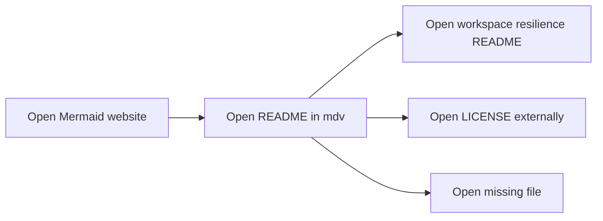
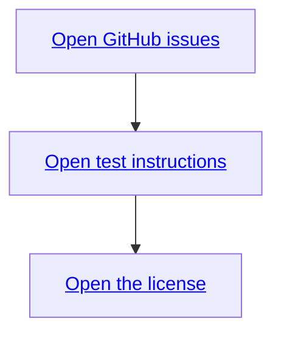
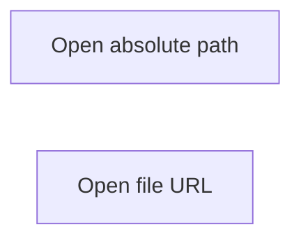

# Mermaid hyperlink examples

Open this document in the GUI and click the diagram nodes below:

```sh
./build/mdv testdata/mermaid-hyperlinks.md
```

HTTP(S) links should open in the default browser. Existing Markdown links should
open inside mdv, and non-Markdown local files should open with their associated
application. The missing-file node should report a broken link.

## Mermaid click statements



## Links embedded in HTML labels



The two diagrams cover multiple links, HTML entities, URL query strings,
relative paths, workspace-root paths, heading fragments, and a local
non-Markdown file.

## Absolute and file URL links

Absolute paths and `file://` URLs are intentionally machine-specific. Replace
these destinations with existing files on the local system to test them:



Spaces and non-ASCII characters should be percent-encoded in file URLs, for
example:

```text
file:///Users/name/My%20Notes/Guide.md#Setup
```
